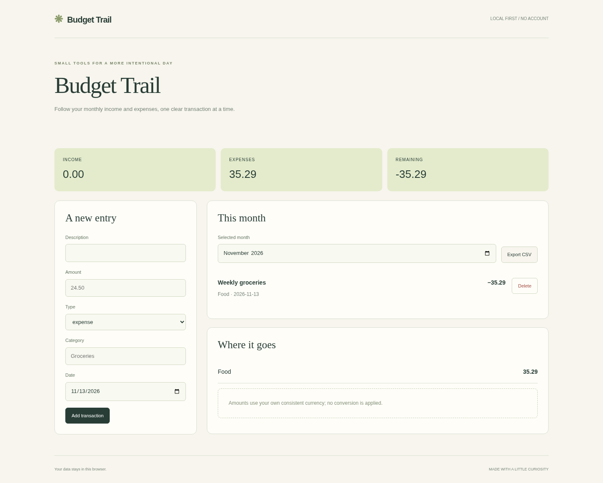

# Budget Trail

Follow your monthly income and expenses, one clear transaction at a time.

## Features

- Exact cent-based money parsing and calculations
- Month filters, category breakdowns, and savings totals
- Income and expense entries with validation and deletion
- CSV export of the selected month

## Get started



Requires **Node.js 20+** for the development server and tests. The app has no runtime dependencies, package install step, or production build.

```sh
git clone https://github.com/oexwashere/budget-trail.git
cd budget-trail
npm start
```

Open `http://127.0.0.1:4180`. Override `PORT` to select a different development port. The server binds only to localhost. ES modules require an HTTP server; opening `index.html` through `file://` is unsupported.

## Your workspace

Start with the empty workspace and add your own records through the labeled forms. Changes are saved in browser storage after each action. Destructive operations are explicit; relevant removals ask for confirmation. Export controls download a local backup or portable report.

Use one browser tab at a time. There is no account or synchronization service. If browser storage is blocked, the app reports that changes cannot be retained.

## Verify

```sh
npm run check
npm test
```

The Node test suite checks the pure domain model, including invalid input and important boundary cases. GitHub Actions is configured for Node 20, 22, and 24. Chromium workflow and responsive-layout checks were also run during development; these are separate from the unit-test command.

## Deploy

Serve `index.html` and `src/` with any static host. Relative paths support project subdirectories. For GitHub Pages, select deployment from `main` and `/ (root)` in Pages settings. No secrets or API keys are needed.

## Architecture

`src/model.js` contains pure domain logic. `src/app.js` owns interactions and rendering. `src/ui.js` provides DOM creation, validated storage loading, forms, and exports. DOM text nodes are used for user-entered content; the app does not execute stored HTML. `server.mjs` is a small development-only static server.

Amounts are parsed into integer cents instead of repeatedly summing floating-point currency. Dates are checked against real calendar dates. Monthly summaries keep income and expenses separate and group expenses by category.

## Limitations and data handling

One currency per workspace; there are no exchange rates, bank connections, recurring transactions, or cross-device sync. Entries are saved locally; CSV export is your backup path. Browser data clearing removes your ledger.

## Contributing

See [CONTRIBUTING.md](CONTRIBUTING.md). Keep changes focused and include a regression test when behavior changes.

## License

[MIT](LICENSE) · oexwashere
